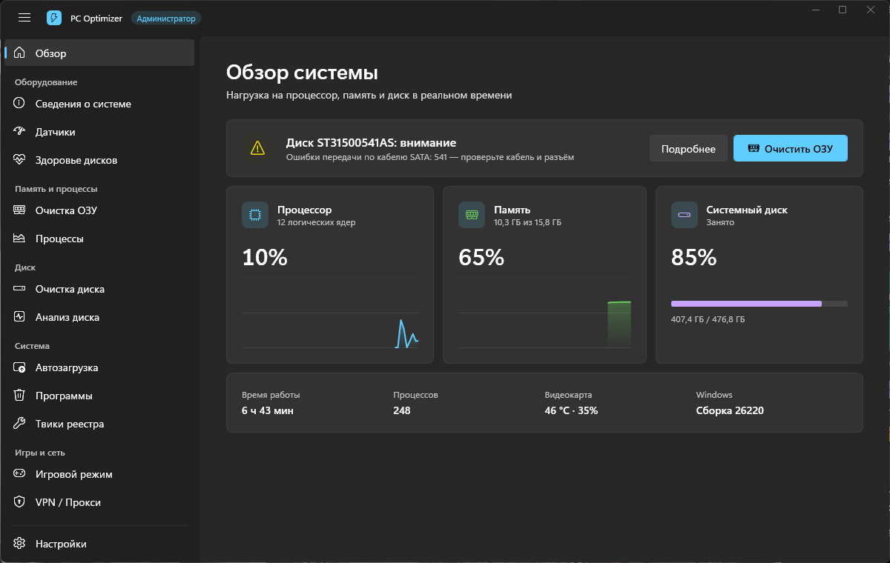
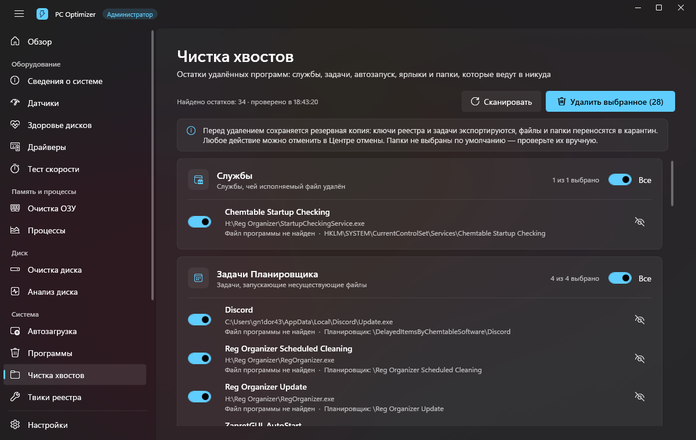
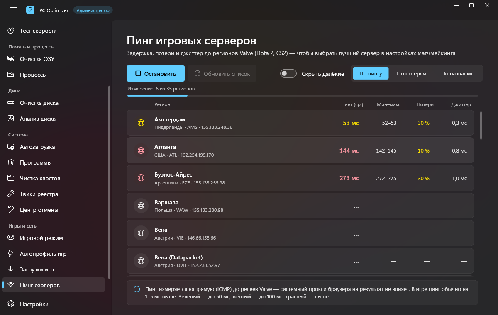
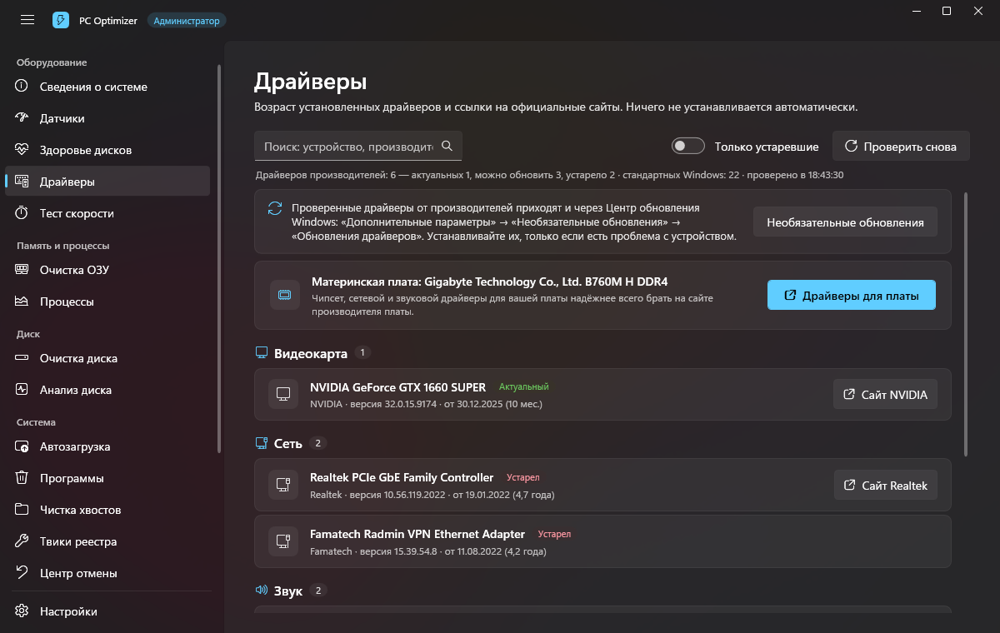
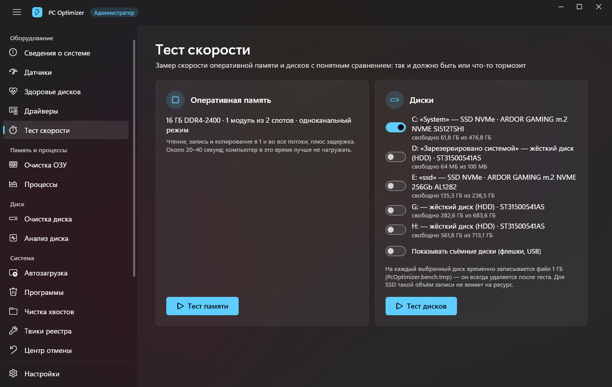
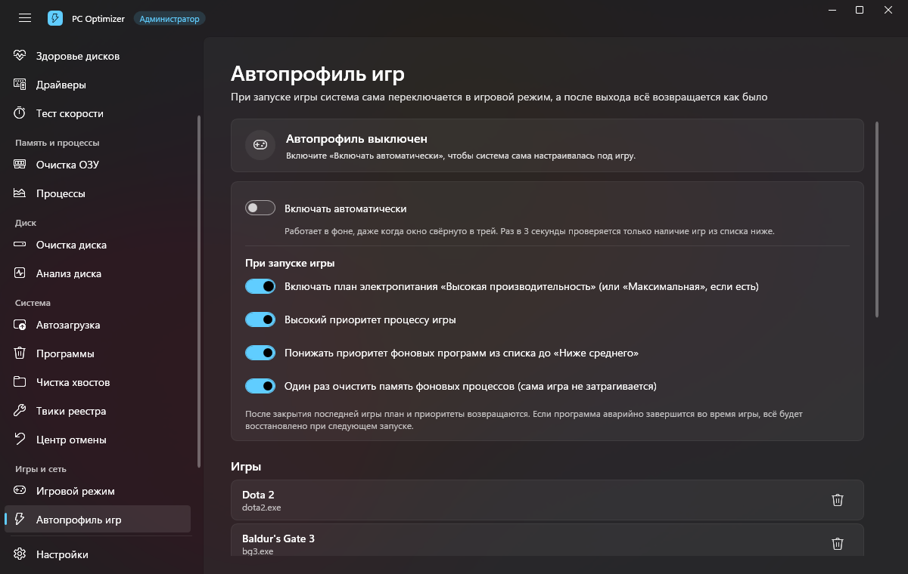
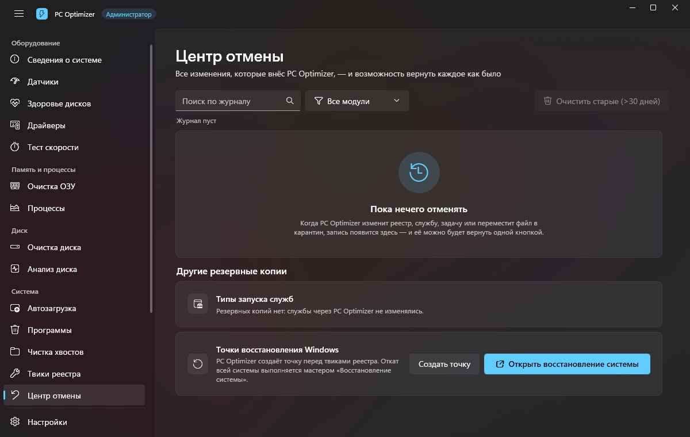

# PC Optimizer

Оптимизатор и диагностика ПК в стиле Windows 11 — всё в одном окне, без рекламы и без лишних служб.

## Скачать

**[⬇ Последняя версия — раздел Releases](../../releases/latest)** → файл `PcOptimizer-Setup-<версия>.exe`.

- Windows 11 (рекомендуется) или Windows 10 версии 1809 и новее, 64-бит.
- .NET устанавливать не нужно — всё уже внутри установщика.
- Программе нужны права администратора (чистка служб, реестра, планов питания).

> Установщик пока без цифровой подписи, поэтому Windows SmartScreen может показать
> «Windows защитила ваш компьютер». Нажмите **Подробнее → Выполнить в любом случае**.

## Возможности

**Оборудование**
- Сведения о системе: процессор, плата, память (слоты, частота, одно-/двухканальный режим), видеокарта, диски.
- Датчики: загрузка и частоты CPU, температура и загрузка видеокарты NVIDIA.
- Здоровье дисков: SMART для NVMe/SSD/HDD с понятным вердиктом (износ, переназначенные сектора, ошибки кабеля).
- Драйверы: возраст каждого драйвера и ссылки на сайт производителя (ничего не устанавливает сам).
- Тест скорости памяти и дисков с подсказками, что тормозит.

**Память, диск, система**
- Очистка ОЗУ (как Mem Reduct), авто-очистка по порогу, процессы.
- Очистка диска и анализ занятого места.
- Автозагрузка: программы, службы, задачи Планировщика, время загрузки Windows, отложенный запуск.
- Удаление программ и **чистка хвостов** после них: мёртвые службы, задачи, ярлыки, папки.
- Безопасные твики реестра с откатом.
- **Центр отмены** — журнал всех изменений, каждое возвращается одной кнопкой.

**Игры и сеть**
- Игровой режим и **автопрофиль**: при запуске игры — высокая производительность и приоритет, после выхода всё возвращается.
- Пинг до серверов Valve (Dota 2, CS2): задержка, потери, джиттер, лучший регион.
- Диагностика скорости загрузок Steam и других лаунчеров.
- Прокси с локальным пересылателем и списком сайтов-исключений.

| | |
|---|---|
|  |  |
|  |  |
|  |  |

## Безопасность

- Перед любым изменением делается резервная копия (ключи реестра, задачи, файлы в карантин) — всё откатывается в «Центре отмены».
- Опасные «ускорители» сознательно не включены; настройки по умолчанию — безопасные.
- Программа ничего не отправляет в интернет, кроме того, что вы сами запускаете (проверка пинга, прокси).

## Удаление

«Параметры → Приложения → PC Optimizer → Удалить». Настройки и журнал отмены остаются в `%APPDATA%\PcOptimizer`.

---

Автор: **gn1dor43** · © 2026. Все права защищены.
